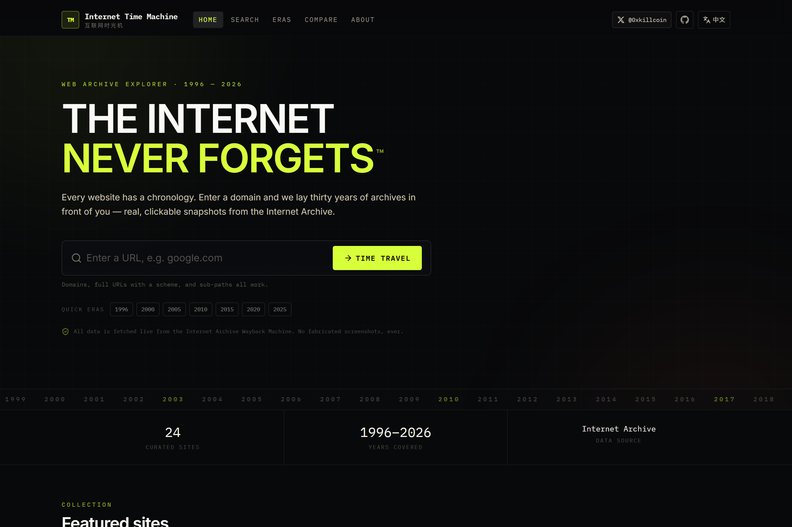
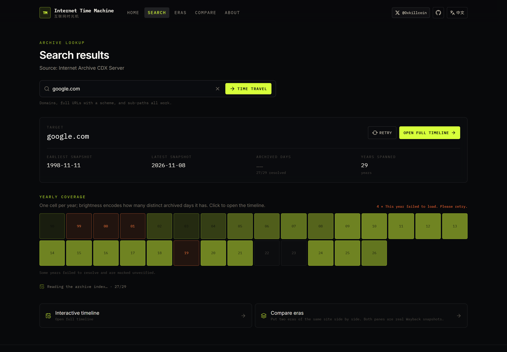
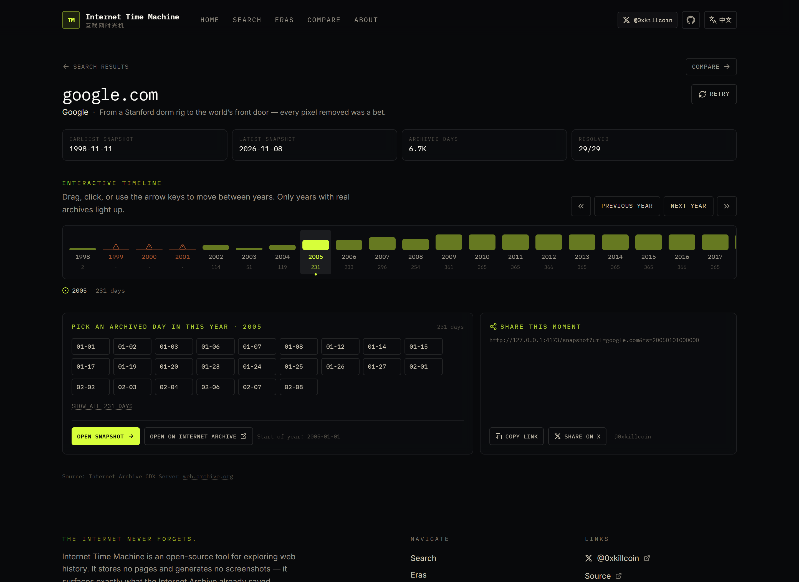
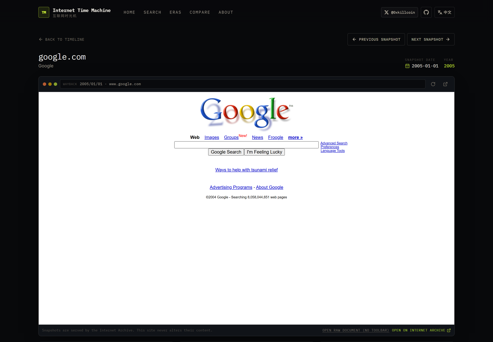
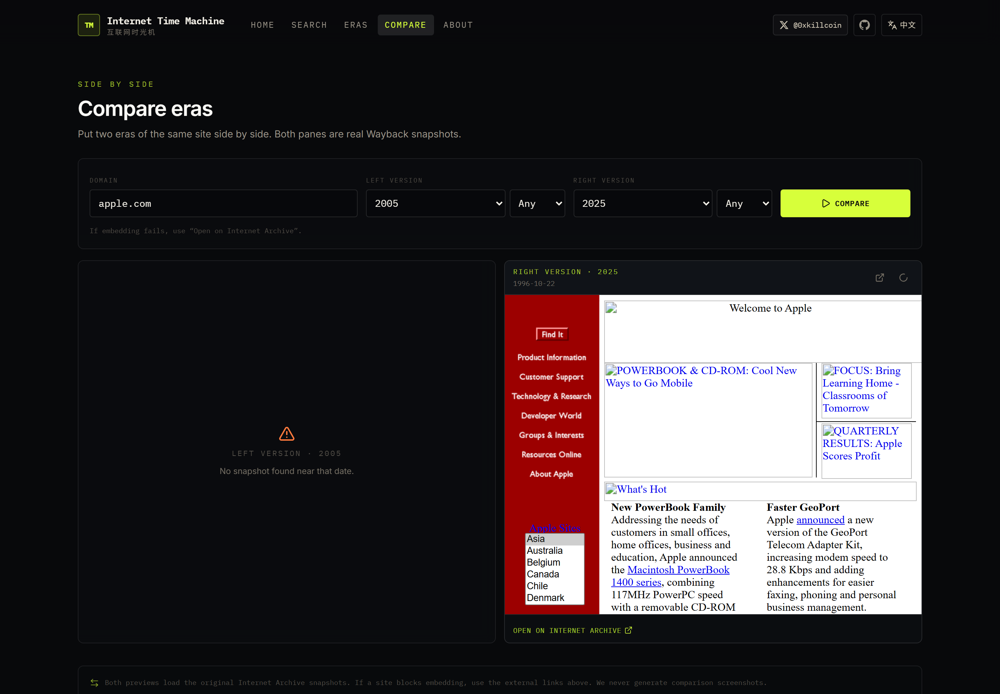
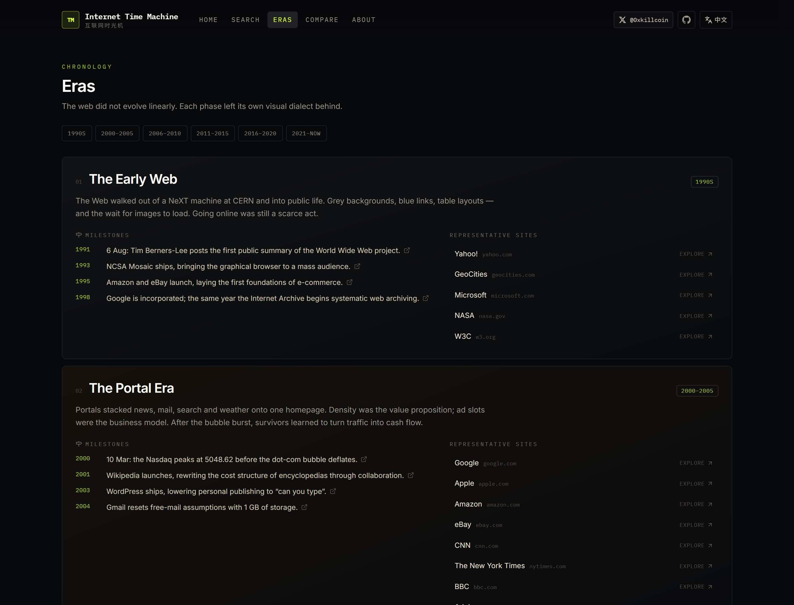
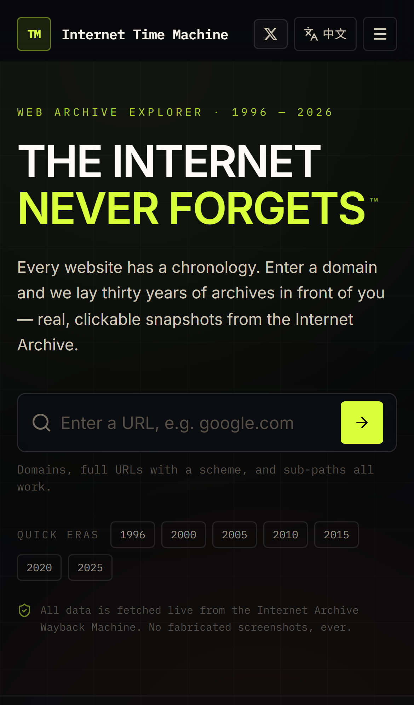
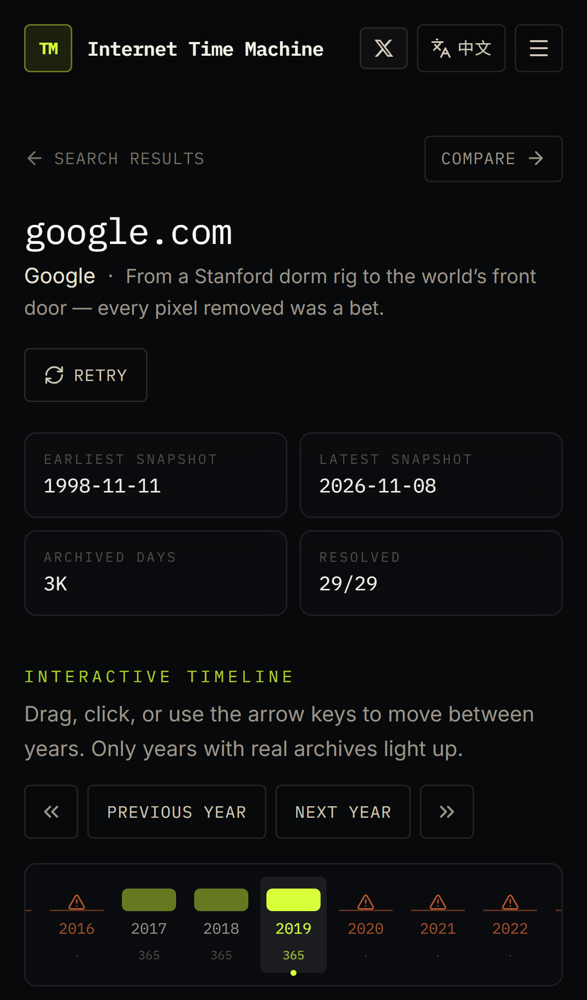
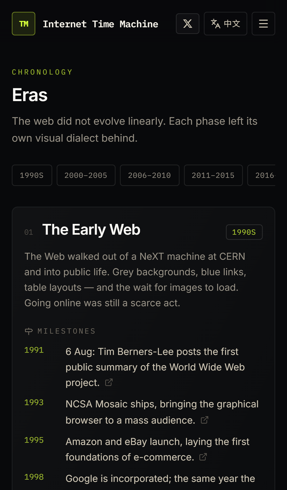

<div align="center">

# 🕰 Internet Time Machine

**The Internet Never Forgets.**

Enter any URL. Travel to its past — real snapshots, real dates, no fabricated screenshots.

[](https://internet-time-machine.pages.dev)
[](LICENSE)
[](https://react.dev)
[](https://www.typescriptlang.org)
[](#-testing)

[English](README.md) · [简体中文](README.zh-CN.md)



</div>

---

## 📖 What this is

Every website has a chronology. **Internet Time Machine** lets you read it.

Type a domain and the app queries the [Internet Archive CDX Server](https://web.archive.org/cdx/search/cdx)
for *actual* archived snapshot dates, aggregates them by year, and hands you an
interactive timeline. Pick a year, pick a day, and the original snapshot opens
inside a CRT-flavoured browser chassis — served straight from the Wayback
Machine.

There is **no mock data**, **no seeded demo**, and **no generated imagery**
anywhere in the product. If the archive has nothing, the UI says so.

> Built by [@0xkillcoin](https://x.com/0xkillcoin) · Open source under MIT

---

## ✨ Features

| | Feature | What it actually does |
|---|---|---|
| 🕰 | **Year timeline** | Probes each year of a site's archive span independently; density bars show how many distinct days were captured. Drag to scrub, arrow keys to step, `Home`/`End` to jump to the oldest/newest year. |
| 🔍 | **Coverage grid** | One cell per year, brightness encodes archived-day count. Failed years are hatched red, not silently shown as empty. |
| 🖥 | **Snapshot viewer** | Embeds the real Wayback snapshot in a retro browser frame, with prev/next day navigation, raw-document link, and an explicit escape hatch when a site blocks `iframe` embedding. |
| ⚖️ | **Era comparison** | Two side-by-side panes, each resolving the closest real snapshot to the chosen year (and optional month). |
| 🗺 | **Era explorer** | Six documented phases from 1991 to today, each with verifiable milestones linked to primary sources. |
| 🎲 | **Random travel** | Rolls a die across domains that are known to carry deep archives. |
| 🔗 | **Shareable moments** | Every snapshot has a canonical URL and an X/Twitter share intent. |
| 🌐 | **Full bilingual UI** | Every screen, error string and empty state is translated — not just the homepage. Auto-detects browser language, remembers your choice. |
| 📱 | **iPhone-first mobile pass** | 16px inputs (no iOS zoom), safe-area padding, 40px+ touch targets, horizontally scrolling timeline rail that never breaks the page. |
| 🛡 | **Hardened proxy** | A minimal edge function that only forwards allow-listed CDX parameters to one hard-coded origin, with SSRF rejection, rate limiting and edge caching. |

---

## 📸 Screenshots

Real captures from the running app — produced by [`scripts/capture-screenshots.mjs`](scripts/capture-screenshots.mjs), not mockups.

### Search coverage



### The interactive timeline



### Real snapshots, framed like an old browser



### Compare two eras



### Eras with sourced milestones



### Mobile (iPhone 14)

<p align="center">
  
  
  
</p>

---

## 🏗 Architecture

```
┌─────────────────────────────┐
│  Browser (React 19 + TS)    │
│  ├─ /            home       │
│  ├─ /explore     coverage   │
│  ├─ /site/:domain timeline  │
│  ├─ /snapshot    viewer     │
│  ├─ /compare     two panes  │
│  ├─ /eras        history    │
│  └─ /about                  │
└──────────────┬──────────────┘
               │  GET /cdx?url=…&from=…&collapse=timestamp:8
               ▼
┌─────────────────────────────┐
│  Cloudflare Pages Function  │  ← policy, not a framework
│  functions/cdx.ts           │
│  ├─ validateTarget()  SSRF  │
│  ├─ allow-list params       │
│  ├─ token bucket            │
│  └─ edge cache (s-maxage)   │
└──────────────┬──────────────┘
               │  hard-coded origin, hostname only
               ▼
┌─────────────────────────────┐
│  web.archive.org            │
│  /cdx/search/cdx            │
└─────────────────────────────┘

Snapshots themselves are loaded by the browser directly from
web.archive.org inside an iframe — they never pass through our proxy.
```

### Why is there a proxy at all?

Because the CDX endpoint sends **no `Access-Control-Allow-Origin` header**. A
browser cannot call it. (Verified: `OPTIONS` returns `405`, and no response
carries `ACAO`.)

Everything else about the setup is deliberately minimal:

- The upstream origin is **hard-coded**; the proxy cannot be pointed elsewhere.
- Only the **hostname** is forwarded, so a path or query cannot smuggle a
  different target.
- Only an **explicit allow-list** of CDX parameters survives.
- Private, loopback, link-local and CGNAT ranges are rejected at the hostname
  level (see the tests in [`functions/lib/cdx-core.test.ts`](functions/lib/cdx-core.test.ts)).

---

## 🧰 Tech stack

| Layer | Choice | Why |
|---|---|---|
| UI | **React 19** + **TypeScript** (strict) | Concurrent rendering, no `any` anywhere |
| Build | **Vite 8** | Fast HMR, tiny production bundles, chunk splitting |
| Styles | **Tailwind CSS 4** | Design tokens in `@theme`, zero runtime CSS-in-JS |
| Routing | **react-router-dom 7** | Real client routes; SPA fallback proves deep links work |
| Icons | **lucide-react** + 2 inline brand marks | Tree-shaken; brand SVGs live in `BrandIcons.tsx` |
| Edge | **Cloudflare Pages Functions** | Free tier, global edge, same repo, no separate service |
| Unit | **Vitest** + Testing Library | 64 tests over pure logic, hooks, i18n and components |
| E2E | **Playwright** | 16 tests across desktop-chromium and iPhone 14 emulation |

No backend framework, no database, no auth, no analytics. There is nothing to
migrate, nothing to leak and nothing to pay for.

---

## 🚀 Quick start

```bash
git clone https://github.com/iiiiiiiiiiiiiKK/internet-time-machine.git
cd internet-time-machine
npm install
npm run dev          # → http://localhost:5173
```

`npm run dev` mounts a local `/cdx` proxy in the Vite server, so the archive
queries work immediately — no Cloudflare account needed to develop.

### Scripts

| Command | Does |
|---|---|
| `npm run dev` | Dev server with the local CDX proxy |
| `npm run build` | Type-check all three TS projects, then bundle to `dist/` |
| `npm run preview` | Serve the production build (also mounts the proxy) |
| `npm run lint` | `oxlint` over `src` and `functions` |
| `npm run typecheck` | `tsc -b` across app, node and functions projects |
| `npm test` | Vitest unit suite |
| `npm run test:e2e` | Playwright suite (desktop + iPhone 14) |
| `npm run pages:dev` | `wrangler pages dev` — real Function runtime |
| `npm run pages:deploy` | Deploy `dist/` to Cloudflare Pages |

---

## 📁 Project structure

```
internet-time-machine/
├── functions/                 # Cloudflare Pages Functions (the only server code)
│   ├── cdx.ts                 #   GET /cdx — the proxy endpoint
│   └── lib/cdx-core.ts        #   shared validation core (+ its unit tests)
├── src/
│   ├── components/            # Header (author 𝕏 link), Timeline, SnapshotFrame, …
│   ├── data/catalog.ts        # curated sites + era definitions with sources
│   ├── hooks/useSiteHistory.ts# streaming per-year archive loader
│   ├── lib/
│   │   ├── wayback.ts         # CDX client: fetchYearDays, fetchBounds, URL builders
│   │   ├── format.ts          # URL normalisation, timestamp math, formatting
│   │   ├── i18n.ts            # the bilingual dictionary (single source of truth)
│   │   ├── timeline.ts        # year-prioritisation + layout helpers
│   │   └── constants.ts       # author / repo / archive links
│   ├── pages/                 # the seven routes
│   ├── test/                  # Vitest suites + setup
│   └── types.ts               # shared domain types
├── e2e/                       # Playwright: app.spec.ts + mobile.spec.ts
├── scripts/capture-screenshots.mjs
├── docs/screenshots/          # real captures used in this README
└── playwright.config.ts
```

---

## 🌐 Deployment

### Cloudflare Pages (recommended — this is what the live demo uses)

The repo is deploy-ready: Pages picks up `functions/` automatically, so the
`/cdx` proxy ships in the same deployment as the static bundle.

**Dashboard route**

1. **Workers & Pages → Create → Pages → Connect to Git**
2. Repository: `iiiiiiiiiiiiiKK/internet-time-machine`, branch `main`
3. Framework preset **Vite** · Build command `npm run build` · Output `dist`
4. Node version `20` or newer (set `NODE_VERSION=20` if your default is older)
5. Deploy

**CLI route**

```bash
npm run build
npx wrangler pages deploy dist --project-name=internet-time-machine
```

No environment variables are required. `VITE_API_BASE` only matters if you host
the proxy on a *different* origin.

### Vercel / Netlify

The static bundle deploys fine, but `functions/cdx.ts` is a Cloudflare Pages
Function. You must port it to the platform's function format — the shared core
in `functions/lib/cdx-core.ts` is runtime-agnostic and can be imported directly.

### GitHub Pages

GitHub Pages serves **static files only** — no Functions — so `/cdx` cannot run
there. Two options:

1. Deploy the proxy elsewhere and set `VITE_API_BASE` at build time; or
2. Skip the archive features (the UI degrades honestly, showing the
   `error.no-proxy` message rather than pretending).

This is why the live demo runs on Cloudflare Pages.

---

## 🧪 Testing

```bash
npm test            # 64 unit tests
npm run test:e2e    # 16 Playwright tests (desktop + iPhone 14)
```

**Unit suite (64 tests)**

| File | Covers |
|---|---|
| `src/test/format.test.ts` | URL normalisation, private-host rejection, timestamp math, compact numbers |
| `src/test/wayback.test.ts` | CDX client behaviour: dedup, sorting, rate limits, safe failure, URL builders |
| `src/test/timeline.test.ts` | Year prioritisation is a permutation; layout helpers |
| `src/test/content.test.ts` | i18n dictionaries are key-identical and actually translated; catalog/era integrity |
| `src/test/header.test.tsx` | Author 𝕏 link href/rel/target; nav routes; language toggle |
| `src/test/searchbox.test.tsx` | Route push, inline validation, private-host refusal, clear button |
| `functions/lib/cdx-core.test.ts` | SSRF matrix (18 blocked targets), param allow-list, range limits, token bucket |

**E2E suite (16 tests)**

- Every route renders and deep links survive a hard reload.
- No console or `pageerror` output on any page.
- Language switch translates header, footer **and** hero, and persists.
- Invalid and private input is rejected before any network call.
- A real domain renders a timeline with real archived-day counts *(live API)*.
- A snapshot page exposes a genuine `web.archive.org/web/<ts>/` iframe URL.
- **iPhone 14 project**: zero horizontal overflow, 40px+ targets, working drawer,
  author link reachable, timeline rail scrolls without breaking the page.

Run `npx playwright test --project=iphone-14` for the mobile gate alone.

---

## ⚠️ Known limitations

- **Embedding is not guaranteed.** Some archived sites send `X-Frame-Options` or
  `frame-ancestors`. When that happens the viewer says so and offers the
  external link — it does not fake a preview.
- **Year-by-year probing is I/O heavy** for very large sites (tens of seconds).
  Years resolve independently and stream in; failures are marked *unverified*,
  not *empty*.
- **Internet Archive rate limits** apply. The proxy adds a per-client token
  bucket and a 15-minute edge cache, but a cold query for a huge site can still
  be throttled.
- **Archive coverage is not editorial.** A missing year means the crawler missed
  it, not that the site did not exist.
- **`snapshot` day navigation** re-probes the current and adjacent years; it
  does not hold an in-memory index of a site's full history.

---

## 🔒 Privacy & security

- **No accounts, no cookies, no analytics, no third-party scripts** beyond the
  Google Fonts stylesheet.
- Your query goes to the Internet Archive and nowhere else.
- The proxy is allow-listed, single-origin, SSRF-guarded and rate-limited.
- All external links carry `rel="noopener noreferrer"`.
- Snapshots are rendered inside a `sandbox`ed iframe.
- No secrets exist in the repository; `.env.example` documents variable *names*
  only.

---

## 🗺 Roadmap

- [ ] Multi-month density heatmap (GitHub-contribution style) per site
- [ ] Domain-level CDX queries (`matchType=domain`) for subpage history
- [ ] Diff mode: extract and compare `<title>`/meta between two snapshots
- [ ] Optional self-hosted CDX mirror support (the `CDX_UPSTREAM` hook exists)
- [ ] Persist the last N explored sites locally (opt-in, no server)

---

## 🤝 Contributing

Issues and PRs are welcome.

```bash
npm install
npm run typecheck && npm run lint && npm test
npm run test:e2e
```

Please keep the project honest: **no mock data, no fake screenshots, no invented
historical facts.** If a feature cannot be implemented against the real archive,
document the limitation instead of simulating it.

---

## 📄 License & credits

Released under the [MIT License](LICENSE).

- Archive data: [Internet Archive](https://archive.org/) — this project would
  not exist without it. Please respect their
  [terms of use](https://archive.org/about/terms.php).
- Built by [**@0xkillcoin**](https://x.com/0xkillcoin) — say hi on 𝕏.

<div align="center">

**The Internet Never Forgets.**

</div>
