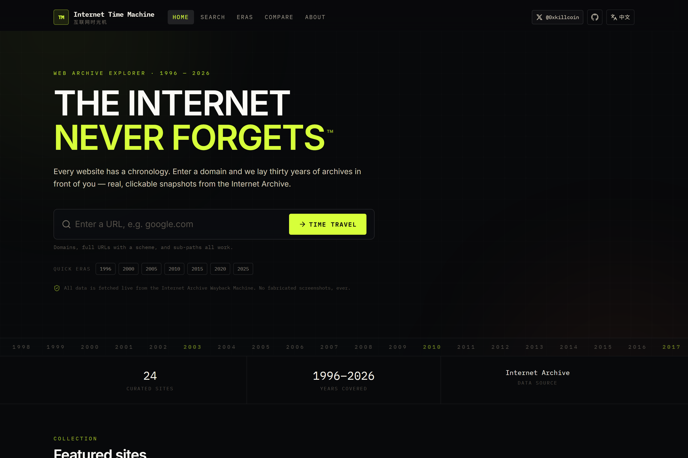
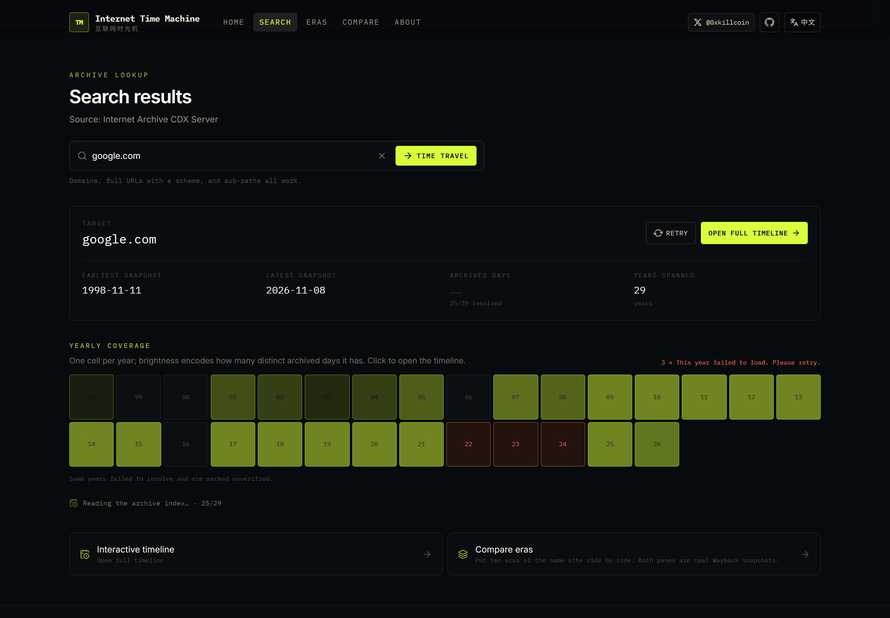
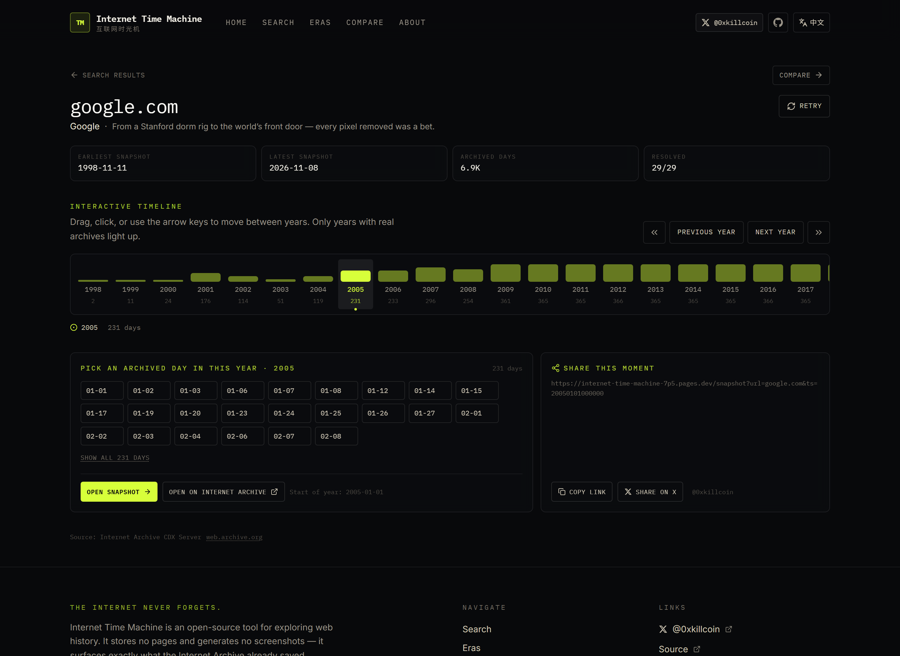
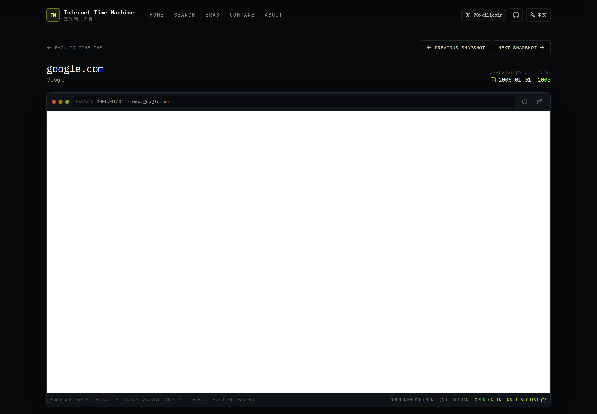
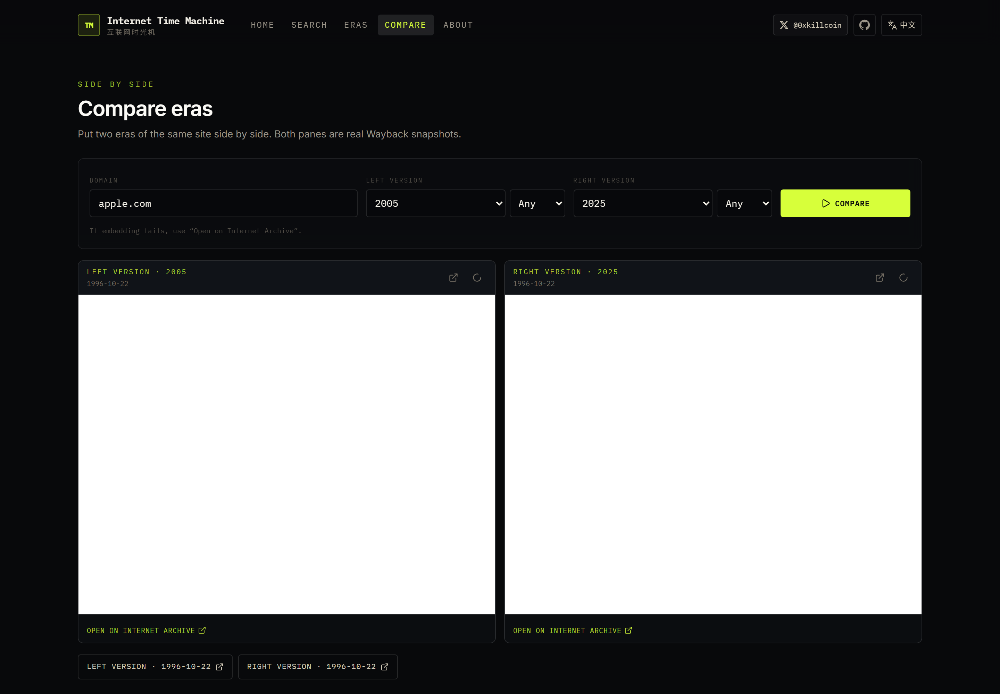
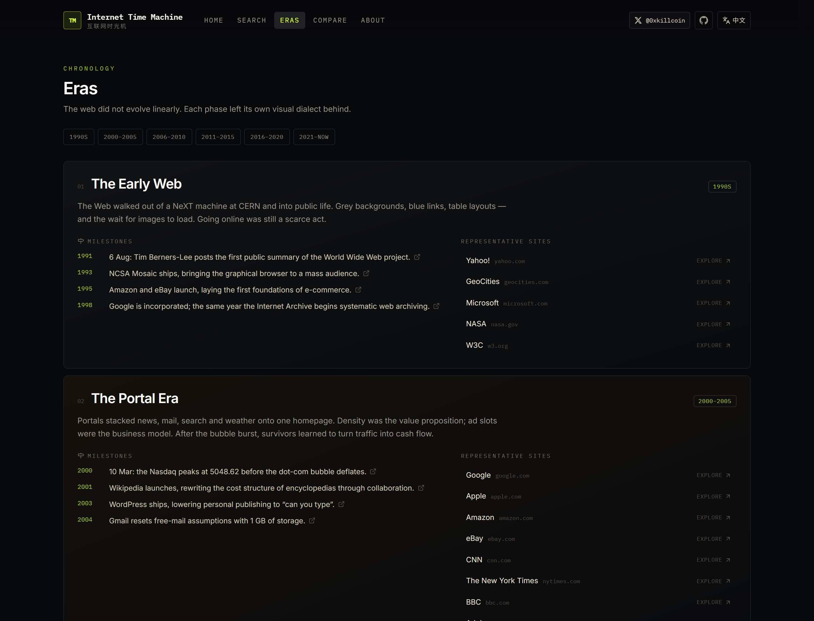
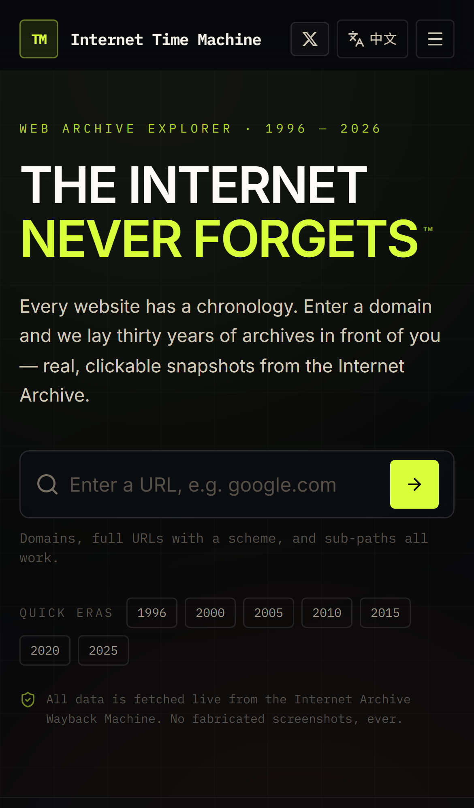
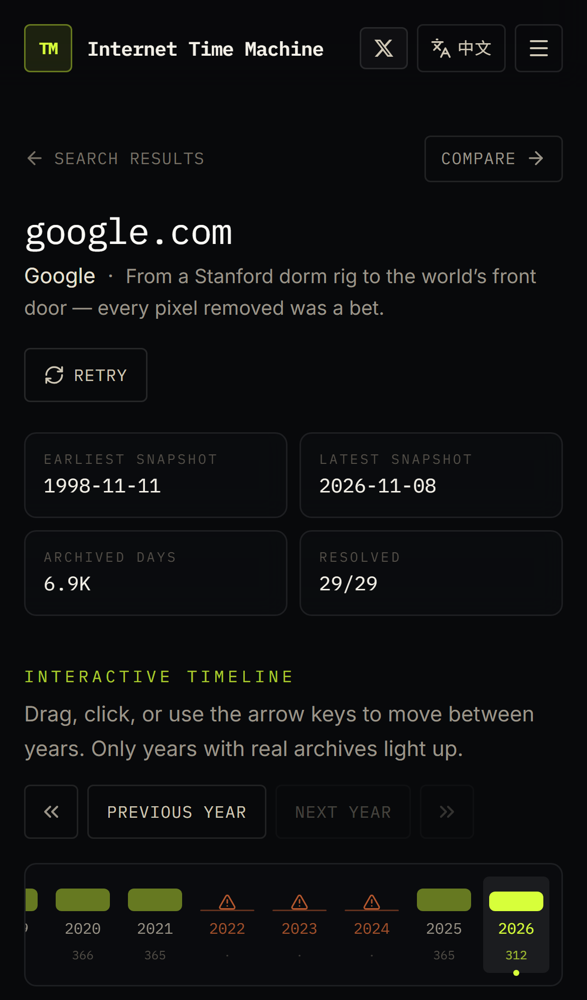
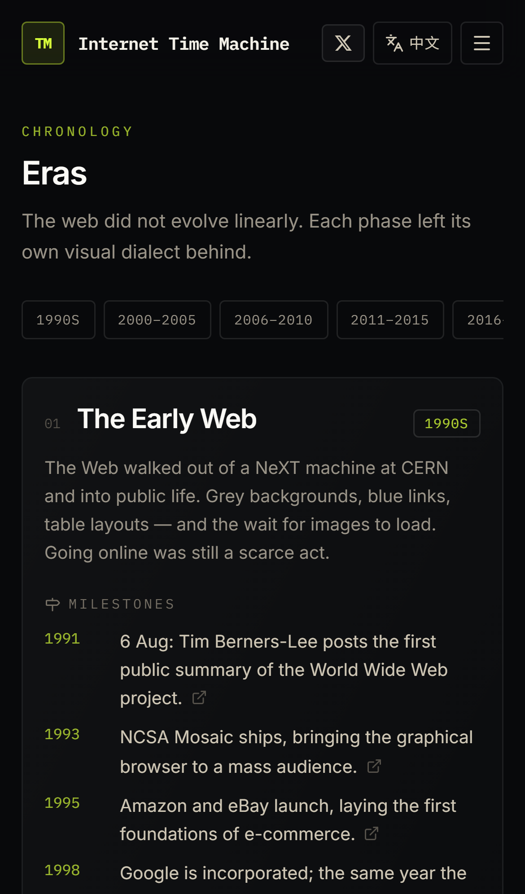

<div align="center">

# 🕰 互联网时光机

**互联网从未真正遗忘。**

输入任意网址，回到它的过去——真实快照、真实日期，没有任何伪造截图。

[](https://internet-time-machine-7p5.pages.dev)
[](LICENSE)
[](https://react.dev)
[](https://www.typescriptlang.org)
[](#-测试)

[English](README.md) · [简体中文](README.zh-CN.md)



</div>

---

## 📖 这是什么

每一个网站都有一部年表。**互联网时光机**让你把它读出来。

输入一个域名，应用会向 [Internet Archive CDX Server](https://web.archive.org/cdx/search/cdx)
请求**真实的**存档快照日期，按年份聚合，然后交给你一条可交互的时间轴。选一个年份，
选一个日期，原始快照就会在一个复古浏览器外壳里打开——直接来自 Wayback Machine。

产品中**没有假数据**、**没有预置演示**、**没有生成图片**。
如果档案里没有，界面就会如实告诉你。

> 由 [@0xkillcoin](https://x.com/0xkillcoin) 构建 · 以 MIT 许可证开源

---

## ✨ 功能

| | 功能 | 它实际做的事 |
|---|---|---|
| 🕰 | **年份时间轴** | 逐年独立探测网站的存档跨度；密度条显示该年有多少个不同的存档日期。拖动可滑动，方向键逐步移动，`Home`/`End` 跳到最早/最新年份。 |
| 🔍 | **覆盖度网格** | 每格代表一年，亮度表示存档日期数量。查询失败的年份显示为红色斜纹，而不是伪装成"无数据"。 |
| 🖥 | **快照浏览器** | 在复古浏览器边框内嵌真实 Wayback 快照，支持上一个/下一个存档日、原始文档链接，以及网站禁止 iframe 嵌入时明确的外部打开出口。 |
| ⚖️ | **年代对比** | 左右两栏，各自解析最接近所选年份（可选月份）的真实快照。 |
| 🗺 | **年代探索** | 从 1991 年至今的六个阶段，每个阶段的关键节点都链接到可核查的原始来源。 |
| 🎲 | **随机穿越** | 在已知有深厚存档的著名站点中掷一次骰子。 |
| 🔗 | **可分享的历史瞬间** | 每个快照都有规范 URL 与 X/Twitter 分享意图。 |
| 🌐 | **完整双语界面** | 每一个页面、错误提示与空状态都有翻译——不只是首页。自动检测浏览器语言并记住选择。 |
| 📱 | **iPhone 优先的移动优化** | 16px 输入框（避免 iOS 自动缩放）、安全区域留白、40px+ 触控目标、可横向滚动的时间轴轨道且不会撑破页面。 |
| 🛡 | **加固的代理** | 极简边缘函数，只把白名单内的 CDX 参数转发到一个硬编码源站，含 SSRF 拦截、速率限制与边缘缓存。 |

---

## 📸 界面截图

以下全部来自运行中的应用（由 [`scripts/capture-screenshots.mjs`](scripts/capture-screenshots.mjs) 生成），不是设计稿。

### 存档覆盖度



### 交互式时间轴



### 真实快照，装在老浏览器里



### 两个年代对比



### 带来源标注的年代探索



### 移动端（iPhone 14）

<p align="center">
  
  
  
</p>

---

## 🏗 架构

```
┌─────────────────────────────┐
│  浏览器（React 19 + TS）     │
│  ├─ /            首页       │
│  ├─ /explore     覆盖度     │
│  ├─ /site/:域名   时间轴     │
│  ├─ /snapshot    快照浏览   │
│  ├─ /compare     并排对比   │
│  ├─ /eras        年代       │
│  └─ /about       关于       │
└──────────────┬──────────────┘
               │  GET /cdx?url=…&from=…&collapse=timestamp:8
               ▼
┌─────────────────────────────┐
│  Cloudflare Pages Function  │  ← 是策略，不是框架
│  functions/cdx.ts           │
│  ├─ validateTarget()  SSRF  │
│  ├─ 参数白名单               │
│  ├─ 令牌桶限流               │
│  └─ 边缘缓存（s-maxage）     │
└──────────────┬──────────────┘
               │  硬编码源站，只接受主机名
               ▼
┌─────────────────────────────┐
│  web.archive.org            │
│  /cdx/search/cdx            │
└─────────────────────────────┘

快照本身由浏览器直接从 web.archive.org 在 iframe 中加载，
不经过我们的代理。
```

### 为什么必须有一个代理？

因为 CDX 接口**不返回 `Access-Control-Allow-Origin` 头**，浏览器无法直接调用。
（已验证：`OPTIONS` 返回 `405`，且任何响应都不含 `ACAO`。）

除此之外，整套设置刻意保持最小：

- 上游源站是**硬编码**的，代理无法被指向别处。
- 只转发**主机名**，路径或查询串无法夹带其它目标。
- 只有**显式白名单**中的 CDX 参数会被保留。
- 私有、回环、链路本地与 CGNAT 地址段在主机名层面即被拒绝
  （见 [`functions/lib/cdx-core.test.ts`](functions/lib/cdx-core.test.ts)）。

---

## 🧰 技术栈

| 层 | 选择 | 原因 |
|---|---|---|
| UI | **React 19** + **TypeScript**（严格） | 并发渲染，全局无 `any` |
| 构建 | **Vite 8** | 极快 HMR、极小产物、自动分包 |
| 样式 | **Tailwind CSS 4** | `@theme` 定义设计令牌，零运行时 CSS-in-JS |
| 路由 | **react-router-dom 7** | 真实客户端路由；SPA 回退保证深层链接可刷新 |
| 图标 | **lucide-react** + 2 个内联品牌图标 | 按需摇树；品牌 SVG 位于 `BrandIcons.tsx` |
| 边缘 | **Cloudflare Pages Functions** | 免费额度、全球边缘、同仓库、无需独立服务 |
| 单元测试 | **Vitest** + Testing Library | 64 个测试覆盖纯逻辑、hook、i18n 与组件 |
| 端到端 | **Playwright** | 16 个测试，覆盖桌面 Chromium 与 iPhone 14 模拟 |

没有后端框架、没有数据库、没有鉴权、没有统计脚本。
没有需要迁移的数据，没有需要泄露的密钥，也没有需要付费的资源。

---

## 🚀 快速开始

```bash
git clone https://github.com/iiiiiiiiiiiiiKK/internet-time-machine.git
cd internet-time-machine
npm install
npm run dev          # → http://localhost:5173
```

`npm run dev` 会在 Vite 服务器中挂载本地 `/cdx` 代理，因此无需 Cloudflare 账号即可开发。

### 常用脚本

| 命令 | 作用 |
|---|---|
| `npm run dev` | 开发服务器（带本地 CDX 代理） |
| `npm run build` | 三个 TS 项目全量类型检查后打包到 `dist/` |
| `npm run preview` | 预览生产构建（同样带代理） |
| `npm run lint` | 对 `src` 与 `functions` 运行 `oxlint` |
| `npm run typecheck` | 对 app / node / functions 执行 `tsc -b` |
| `npm test` | Vitest 单元测试 |
| `npm run test:e2e` | Playwright 端到端测试（桌面 + iPhone 14） |
| `npm run pages:dev` | `wrangler pages dev`——真实 Function 运行时 |
| `npm run pages:deploy` | 把 `dist/` 部署到 Cloudflare Pages |

---

## 📁 目录结构

```
internet-time-machine/
├── functions/                 # Cloudflare Pages Functions（唯一的服务端代码）
│   ├── cdx.ts                 #   GET /cdx —— 代理端点
│   └── lib/cdx-core.ts        #   共享校验核心（含单元测试）
├── src/
│   ├── components/            # 头部（作者 𝕏 链接）、时间轴、快照框…
│   ├── data/catalog.ts        # 精选站点 + 带来源的年代定义
│   ├── hooks/useSiteHistory.ts# 逐年流式加载存档索引
│   ├── lib/
│   │   ├── wayback.ts         # CDX 客户端：fetchYearDays / fetchBounds / URL 构造
│   │   ├── format.ts          # URL 规范化、时间戳计算、格式化
│   │   ├── i18n.ts            # 双语文案字典（唯一来源）
│   │   ├── timeline.ts        # 年份优先级排序 + 布局辅助
│   │   └── constants.ts       # 作者 / 仓库 / 档案馆链接
│   ├── pages/                 # 七个路由页面
│   ├── test/                  # Vitest 测试与 setup
│   └── types.ts               # 共享领域类型
├── e2e/                       # Playwright：app.spec.ts + mobile.spec.ts
├── scripts/capture-screenshots.mjs
├── docs/screenshots/          # README 使用的真实截图
└── playwright.config.ts
```

---

## 🌐 部署

### Cloudflare Pages（推荐，在线演示即使用此方案）

仓库已可直接部署：Pages 会自动识别 `functions/`，因此 `/cdx` 代理与静态产物一起上线。

**面板方式**

1. **Workers & Pages → Create → Pages → Connect to Git**
2. 仓库：`iiiiiiiiiiiiiKK/internet-time-machine`，分支 `main`
3. 框架预设 **Vite** · 构建命令 `npm run build` · 输出目录 `dist`
4. Node 版本 `20` 或更新（如默认更旧，设置 `NODE_VERSION=20`）
5. 部署

**命令行方式**

```bash
npm run build
npx wrangler pages deploy dist --project-name=internet-time-machine
```

无需任何环境变量。只有当代理部署在**不同源**时，才需要 `VITE_API_BASE`。

### Vercel / Netlify

静态产物可以直接部署，但 `functions/cdx.ts` 是 Cloudflare Pages Function，
需要改写成对应平台的函数格式——`functions/lib/cdx-core.ts` 中的共享核心与运行时无关，
可直接 import 复用。

### GitHub Pages

GitHub Pages **只提供静态文件**，没有 Functions，因此 `/cdx` 无法运行。两种方案：

1. 把代理部署到别处，并在构建时设置 `VITE_API_BASE`；
2. 或者不使用存档功能（界面会如实显示 `error.no-proxy` 提示，而不是假装成功）。

这也是在线演示选择 Cloudflare Pages 的原因。

---

## 🧪 测试

```bash
npm test            # 64 个单元测试
npm run test:e2e    # 16 个 Playwright 测试（桌面 + iPhone 14）
```

**单元测试（64 个）**

| 文件 | 覆盖内容 |
|---|---|
| `src/test/format.test.ts` | URL 规范化、私有地址拒绝、时间戳计算、紧凑数字格式 |
| `src/test/wayback.test.ts` | CDX 客户端行为：去重、排序、限流、安全失败、URL 构造 |
| `src/test/timeline.test.ts` | 年份优先级排序是一个排列；布局辅助函数 |
| `src/test/content.test.ts` | 双语字典键完全一致且确有翻译；目录与年代数据完整性 |
| `src/test/header.test.tsx` | 作者 𝕏 链接的 href/rel/target；导航路由；语言切换 |
| `src/test/searchbox.test.tsx` | 路由跳转、内联校验、私有地址拒绝、清空按钮 |
| `functions/lib/cdx-core.test.ts` | SSRF 矩阵（18 个被拦截目标）、参数白名单、范围限制、令牌桶 |

**端到端测试（16 个）**

- 所有路由可渲染，深层链接强制刷新后依然可用。
- 任何页面都不产生 console 或 `pageerror` 输出。
- 语言切换会翻译头部、页脚**与**主视觉，并且刷新后保持。
- 非法与私有输入在发出任何网络请求之前即被拒绝。
- 真实域名能渲染出带真实存档日数量的时间轴*（调用真实 API）*。
- 快照页暴露真实的 `web.archive.org/web/<ts>/` iframe 地址。
- **iPhone 14 项目**：零横向溢出、40px+ 触控目标、抽屉可用、
  作者链接可达、时间轴轨道可滚动且不撑破页面。

只跑移动端门禁：`npx playwright test --project=iphone-14`。

---

## ⚠️ 已知限制

- **不保证可内嵌。** 部分存档站点会发送 `X-Frame-Options` 或 `frame-ancestors`。
  遇到这种情况，查看器会明确说明并提供外部链接——不会伪造预览。
- **逐年探测对超大站点 I/O 较重**（可能需要数十秒）。年份独立解析并流式返回；
  失败年份标记为*未验证*，而不是*为空*。
- **Internet Archive 有速率限制。** 代理加了按客户端令牌桶与 15 分钟边缘缓存，
  但对超大站点的冷查询仍可能被短暂限流。
- **存档覆盖不是编辑行为。** 某一年缺失只说明爬虫没有抓到，不代表网站当时不存在。
- **快照页的日期导航**会重新探测当前年与相邻年份，不缓存站点完整历史索引。

### 复现验证

```bash
npm run test:e2e                                    # 本地构建，两个项目全跑
node scripts/verify-production.mjs <部署地址>       # 对线上站点做冒烟验证
node scripts/capture-screenshots.mjs <部署地址>     # 重新生成 README 截图
```

`verify-production.mjs` 会在部署地址上逐项断言：边缘函数返回真实 CDX 数据且带 CORS、
SSRF 与非法主机被拒绝、时间轴渲染出 25 年真实数据、快照 iframe 指向
`web.archive.org`、控制台无报错，以及 iPhone 14 零横向溢出且抽屉可用。

---

## 🔒 隐私与安全

- **无账号、无 Cookie、无统计、无第三方脚本**（仅 Google Fonts 样式表）。
- 你的查询只发往 Internet Archive，不会流向别处。
- 代理采用白名单、单源站、SSRF 防护与速率限制。
- 所有外部链接均带 `rel="noopener noreferrer"`。
- 快照在带 `sandbox` 的 iframe 中渲染。
- 仓库中不存在任何密钥；`.env.example` 只记录变量**名称**。

---

## 🗺 后续计划

- [ ] 按月密度热力图（GitHub 贡献图风格）
- [ ] 域名级 CDX 查询（`matchType=domain`），覆盖子页面历史
- [ ] 差异模式：提取并对比两个快照的 `<title>` / meta
- [ ] 支持自建 CDX 镜像（`CDX_UPSTREAM` 钩子已就绪）
- [ ] 本地记录最近浏览的站点（需主动开启，无服务端）

---

## 🤝 参与贡献

欢迎提 Issue 与 PR。

```bash
npm install
npm run typecheck && npm run lint && npm test
npm run test:e2e
```

请保持项目的诚实性：**不使用假数据，不伪造截图，不编造历史事实。**
如果某个功能无法基于真实档案实现，请记录限制，而不是模拟它。

---

## 📄 许可证与致谢

以 [MIT 许可证](LICENSE) 发布。

- 存档数据：[Internet Archive](https://archive.org/)——没有它这个项目不会存在。
  请遵守其[使用条款](https://archive.org/about/terms.php)。
- 由 [**@0xkillcoin**](https://x.com/0xkillcoin) 构建——欢迎在 𝕏 上打招呼。

<div align="center">

**互联网从未真正遗忘。**

</div>
